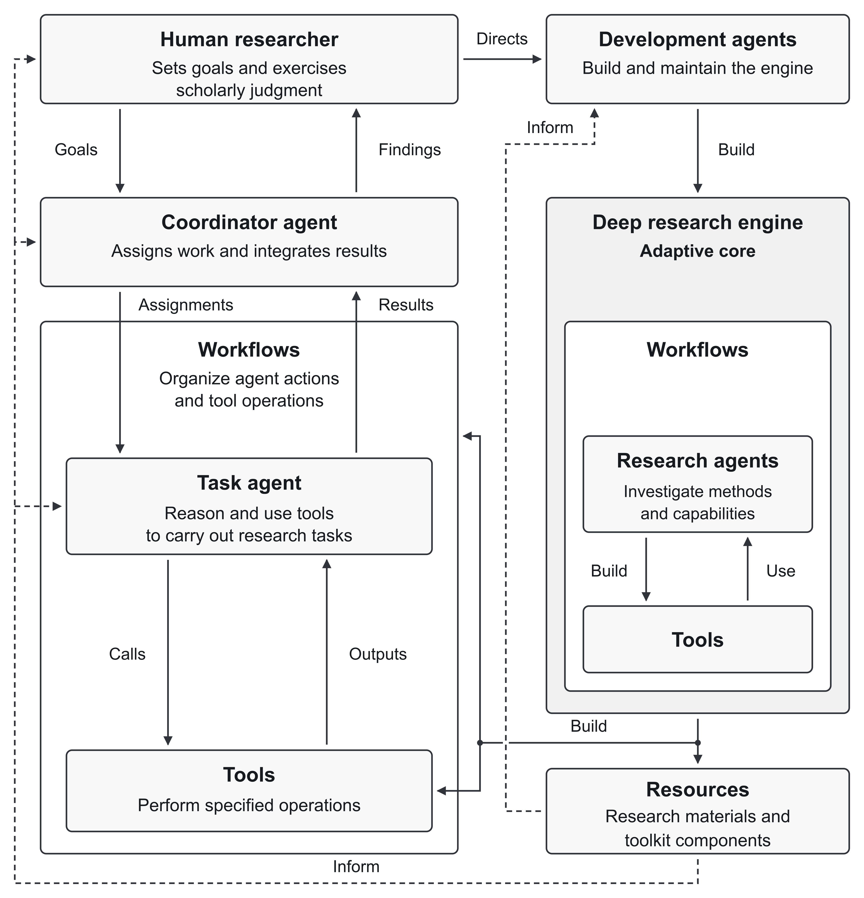
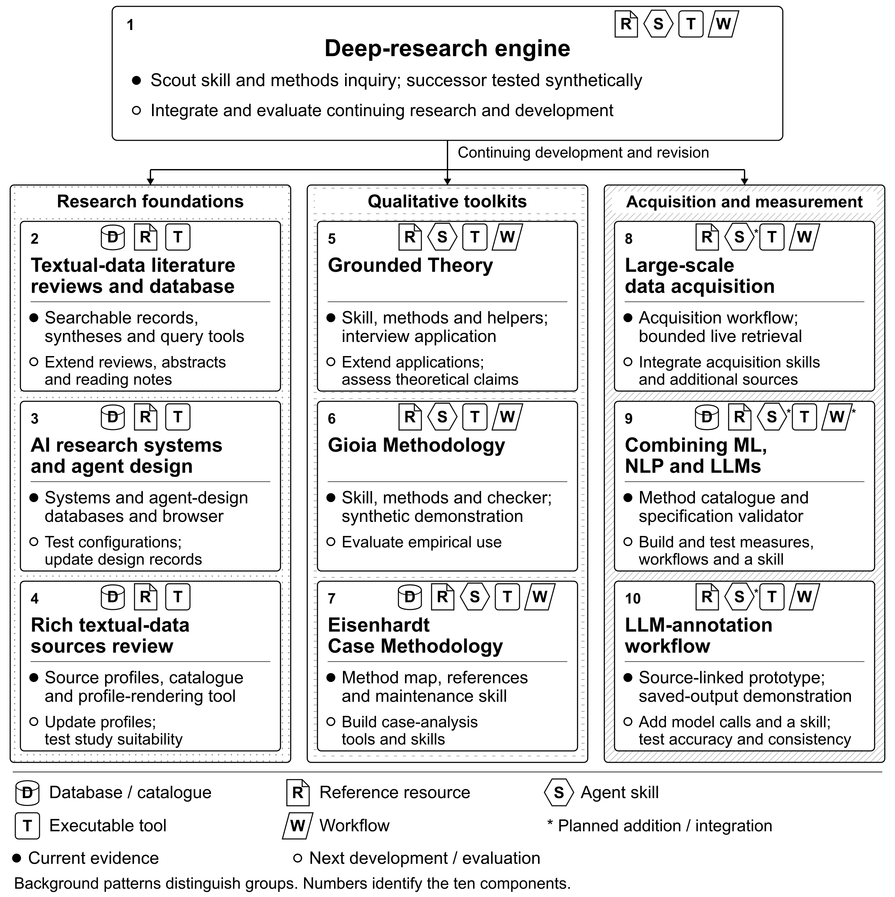

# TextData

**TextData expands what organizational researchers can do with text data.**

*Adaptive AI Infrastructure for Organizational Research*

[Website](https://textdata.info/) · [Interactive design](https://textdata.info/how-it-works/) · [Extending TextData](EXTENDING.md)

TextData is an adaptive AI research infrastructure that draws on frontier large language models (LLMs) to acquire, prepare, and analyze textual data in management research. It combines AI agents, tools, workflows, and resources under researcher direction and is designed to help researchers examine extensive textual evidence, construct organizational measures, and refine theoretical explanations, while they retain authority over methods and conclusions. A deep-research engine, the adaptive core, is designed to keep the infrastructure current as LLMs advance and open-source communities develop new components.

The website offers illustrative demonstrations and searchable resources. This repository provides the finished resources, runnable examples and concise usage guides. Component numbers match the proposal and its technical appendix.

## The design

*Explore the figure interactively on the website.*

The figure shows how the infrastructure is intended to work.

On the **left**, a coordinator agent turns the researcher’s goals into assignments. Task agents reason and use tools; workflows organize their work. Findings return to the researcher for examination.

On the **right**, development agents build and maintain the deep-research engine. Research agents work within it to investigate methods and capabilities, building and using tools in that inquiry. Evidence and conclusions accumulate in a shared knowledge vault for retrieval and reconsideration.

**Resources connect research with capability development.** They preserve evidence, methodological guidance, conclusions, and toolkit components. They inform both the conduct of a study and the continuing development of its research infrastructure. The human researcher retains authority over methodological choices, interpretations, and scholarly claims.

## The ten components

*Components and development status. Arrows indicate the engine’s intended support for each group’s continuing development. Asterisks mark proposed additions or integration.*

Each folder under [`appendix/`](appendix/) introduces one component, its available resources and a working example. Its `AI-PROMPT.md` helps you explore the component with your own AI assistant.

### Deep-research engine

| No. | Component | Completed work and evidence | Folder | Webpage |
|---|---|---|---|---|
| 1 | Deep-research engine | Research protocols, a scout skill and software helpers support successive inquiry. The successor helper has been tested on synthetic inputs only. | [`01-engine`](appendix/01-engine/) | [Webpage](https://textdata.info/engine/) |

### Research foundations

| No. | Component | Completed work and evidence | Folder | Webpage |
|---|---|---|---|---|
| 2 | Textual-data literature reviews and database | Three methodological syntheses and a searchable database. Included review materials contain two syntheses and 10,732 entries from overlapping catalogues. | [`02-literature`](appendix/02-literature/) | [Webpage](https://textdata.info/foundation/literature-reviews/) |
| 3 | AI research systems and agent design | Two databases document AI research systems and agent designs. | [`03-agent-design`](appendix/03-agent-design/) | [Webpage](https://textdata.info/foundation/ai-research-systems/) |
| 4 | Rich textual-data sources review | A catalogue, dated profiles, comparative review and profile-rendering tool describe coverage and observability. | [`04-data-sources`](appendix/04-data-sources/) | [Webpage](https://textdata.info/foundation/textual-data-sources/) |

### Qualitative toolkits

| No. | Component | Completed work and evidence | Folder | Webpage |
|---|---|---|---|---|
| 5 | Grounded Theory | An agent skill combines methods, workflows, templates and software helpers. A worked analysis covers 22 interviews. | [`05-grounded-theory`](appendix/05-grounded-theory/) | [Webpage](https://textdata.info/toolkit/grounded-theory/) |
| 6 | Gioia Methodology | An agent skill, templates and quotation checker support concept development. A synthetic example illustrates the distinction between checking quotations and judging an interpretation. | [`06-gioia-methodology`](appendix/06-gioia-methodology/) | [Webpage](https://textdata.info/toolkit/gioia-methodology/) |
| 7 | Eisenhardt Case Methodology | A method map, reference collection and maintenance skill support case-method research preparation. Case analysis remains proposed. | [`07-eisenhardt-case-methodology`](appendix/07-eisenhardt-case-methodology/) | [Webpage](https://textdata.info/toolkit/eisenhardt-case-methodology/) |

### Acquisition and measurement

| No. | Component | Completed work and evidence | Folder | Webpage |
|---|---|---|---|---|
| 8 | Large-scale data acquisition | An inventory covers 806,941 historical document records. A working comparison illustrates acquisition and verification for 191 documents. | [`08-data-acquisition`](appendix/08-data-acquisition/) | [Webpage](https://textdata.info/toolkit/large-scale-data-acquisition/) |
| 9 | Combining ML, NLP and LLMs | A methods catalogue, measurement specifications and a validator support research design. The proposed product-description measure has no scores. | [`09-measurement`](appendix/09-measurement/) | [Webpage](https://textdata.info/toolkit/combining-ml-nlp-llms/) |
| 10 | LLM-annotation workflow | Tools prepare requests, check quotations and export features. Saved responses for five passages illustrate the workflow; source checks do not establish annotation accuracy. | [`10-annotation`](appendix/10-annotation/) | [Webpage](https://textdata.info/toolkit/llm-annotation-workflow/) |

ML: machine learning; NLP: natural language processing; LLM: large language model.

This work establishes working parts of the design. Integration and research validity require further evaluation.

## What this repository holds

The repository provides tools, data and worked examples for components 1–10. Each component’s README shows how to begin, what works now and what remains proposed. The component folders are indexed in [`appendix/README.md`](appendix/README.md).

Project code is licensed under [Apache 2.0](LICENSE); project-authored documentation and data are licensed under [CC BY 4.0](LICENSE-docs). Third-party material retains its own terms, recorded in the component notices.

## Extending TextData

See [Extending TextData](EXTENDING.md) for planned extensions and ways to build on the infrastructure.
